# AgentCompiler

**Compiler-inspired agent orchestration through structured plans and dependency-driven execution.**

A continuation of the undergraduate thesis **AgentCompiler: An LLM Compiler for Parallel Multi-Agent Orchestration**, by João Pedro de Moraes Madruga at the Federal University of Pernambuco (UFPE), Center for Informatics, supervised by Filipe Carlos de Albuquerque Calegario.

> **Status: implemented runtime.** DAG validation, optimization, asynchronous execution, LLM planning, tool-enabled specialists, synthesis, and bounded replanning are implemented. Integration was exercised with Python agents and a local Chat Completions endpoint. No unit tests were created or run. Live-provider quality and performance benchmarks remain unverified; `benchmark/` is still an empty scaffold.

## Overview

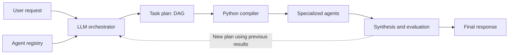

| The LLM decides | Python controls |
|---|---|
| Request decomposition | Contract and graph validation |
| Required specialists | Contract-permitted optimizations |
| Inputs and semantic dependencies | Scheduling and concurrency |
| Synthesis and whether to replan | State, limits, failures, and results |

## Why a graph?

A task may feed multiple consumers, and a task may depend on multiple results. The plan explicitly represents these relationships as a **directed acyclic graph (DAG)**.

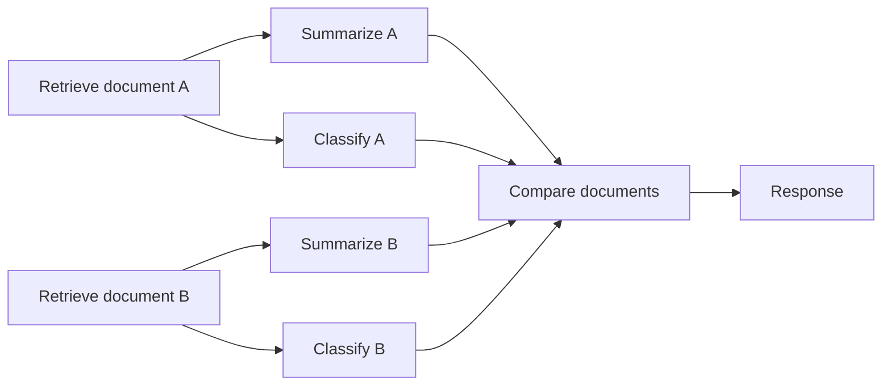

**Dependencies determine readiness; position in the plan does not impose a barrier.** Summarizing A can start as soon as retrieving A finishes, even while retrieving B is still running.

## Compiler pipeline

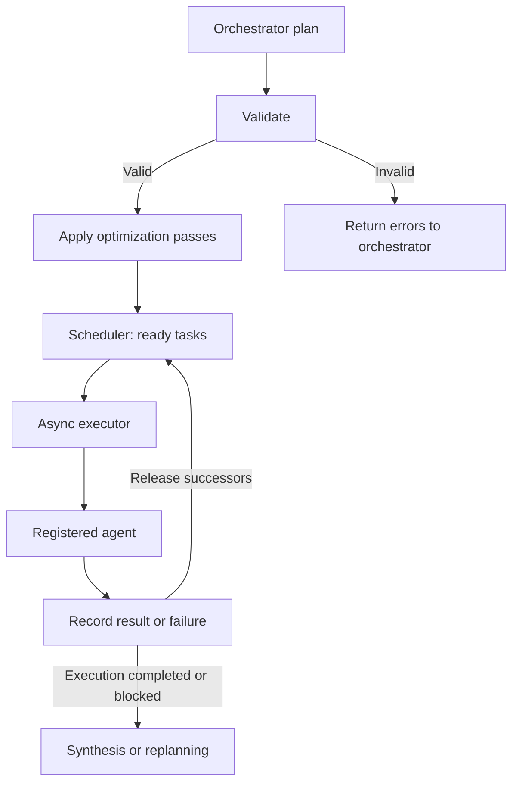

| Stage | Runtime responsibility |
|---|---|
| Validation | Unique IDs, registered agents, valid references, compatible contracts, and absence of cycles |
| Optimization | Transform the graph while preserving requested outputs and declared effects |
| Scheduler | Release tasks with satisfied dependencies within the concurrency limit |
| Executor | Invoke agents, enforce limits, and record completion or failure |
| Synthesis | Produce the response or request another planning round |

### Plan contracts

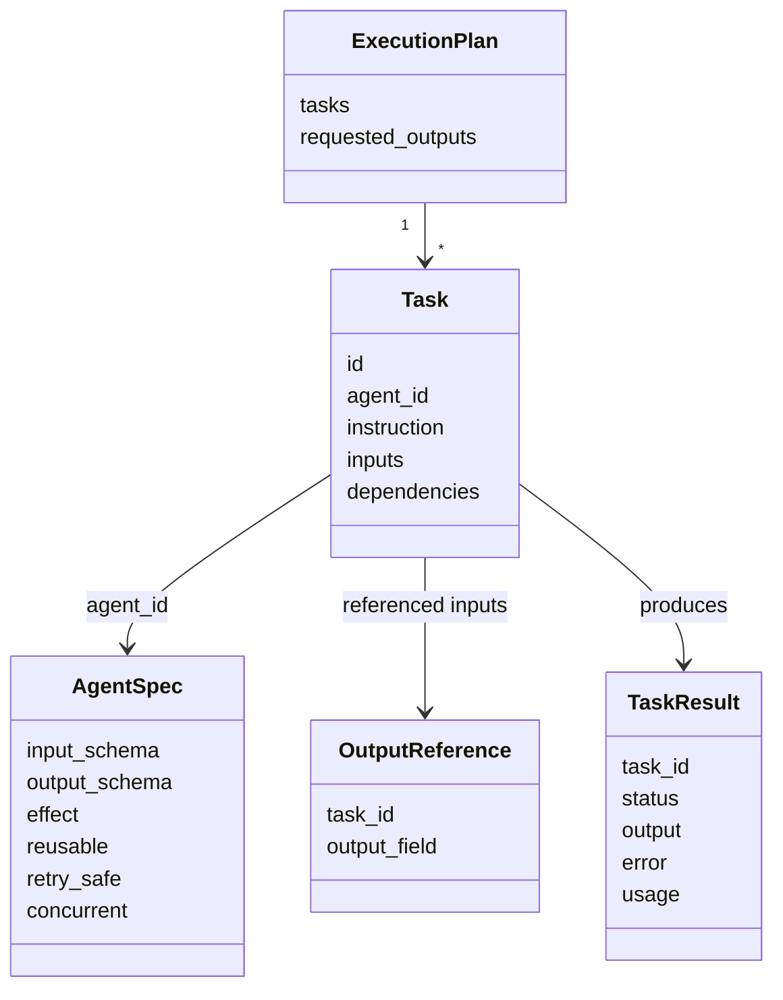

Tasks bind named inputs to literal JSON values or references to earlier outputs. Reference paths use RFC 6901 JSON pointers: `""` selects the entire output, and `"/words"` selects a field. References create dependencies automatically; `dependencies` adds semantic ordering constraints.

Agent schemas and effect declarations come from the trusted registry, not from the LLM. Contracts are validated before execution where their shape is known and again against actual inputs and outputs at runtime.

## Implemented optimizations

The compiler applies independent passes after graph validation and validates the resulting graph again. Each transformation is recorded in the execution report.

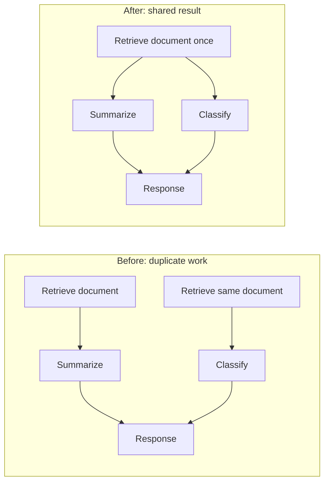

| Pass | Application condition |
|---|---|
| Deduplication | Same registered agent/version, instruction, bindings, and dependencies within one run; explicitly reusable result |
| Dead task elimination | Task is explicitly pure and does not contribute to a requested output or a read/write task |

Two LLM calls with similar instructions are not automatically equivalent. Independent evaluations must remain independent. Writes and other external actions need declared effects to prevent incorrect transformations.

### Scheduling

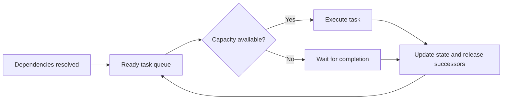

| Implemented | Future extension |
|---|---|
| Topological validation and dependency-driven readiness | Automatic duration estimation from traces |
| FIFO or estimated critical-path priority | Streaming planning |
| Bounded concurrency and no layer barriers | Further optimization passes |

Topological ordering guarantees a valid order, not minimum latency. Benefits depend on dependencies, task duration, and resource limits.

## Specialized agents

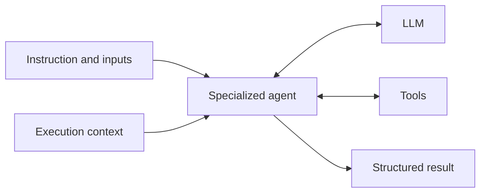

The registry describes capabilities and contracts. The compiler schedules tasks, and the same agent may execute distinct tasks. `concurrent=False` serializes invocations of a registered agent across runs sharing the registry, on the same event loop.

| Agent | Execution |
|---|---|
| `FunctionAgent` | An async Python function receiving instruction, resolved inputs, and run context |
| `LLMAgent` | A caller-provided role prompt and model, optionally using real registered tools |

Tool inputs and outputs are schema-validated. Tool observations feed the next model call. Tool calls within a specialist execute sequentially; separate DAG tasks execute concurrently. An agent's effect, reuse, retry, and concurrency declarations must be compatible with its tools.

Customer support, research, and other experimental specialists will be defined later inside `benchmark/`, keeping the runtime independent of a specific domain.

## Execution lifecycle

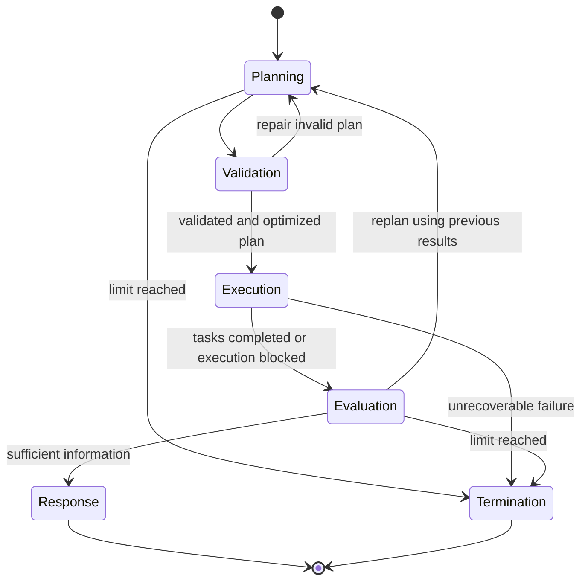

Replanning preserves successful results. Every new task needs a fresh ID; new plans can reference successful results from previous rounds. Removed task IDs remain reserved. Retrying a task requires both a retry-safe agent contract and an explicitly retryable `AgentExecutionError`.

| Outcome | Behavior |
|---|---|
| Task failure | Dependent tasks become blocked; independent work continues |
| Task timeout | Task fails; dependencies become blocked |
| Run timeout | Running tasks are cancelled and partial results are retained |
| Caller cancellation | Child tasks are cancelled and awaited; cancellation propagates |
| Uncertain write-tool failure | Specialist fails without automatic replay of the tool loop |
| Replanning budget exhausted | Run stops without claiming completion |

Cancellation cannot undo external effects. Handlers must be cooperative async functions and handle their own external cleanup.

## Repository layout

```text
AgentCompiler/
├── AGENTS.md
├── src/
│   ├── __init__.py          # Public runtime API
│   ├── __main__.py          # Service-factory CLI
│   ├── agents/
│   │   ├── orchestrator/
│   │   │   ├── agent.py
│   │   │   ├── schemas.py
│   │   │   └── prompts/
│   │   │       ├── planning.py
│   │   │       └── synthesis.py
│   │   ├── base.py
│   │   ├── registry.py
│   │   ├── context.py
│   │   └── schemas.py
│   ├── compiler/
│   │   ├── compiler.py
│   │   ├── schemas.py
│   │   ├── validation.py
│   │   ├── scheduler.py
│   │   ├── executor.py
│   │   └── optimizations/
│   │       ├── deduplication.py
│   │       └── dead_tasks.py
│   ├── core/
│   │   ├── config.py
│   │   ├── llm.py
│   │   └── tracing.py
│   └── services/
│       └── execution_service.py
├── benchmark/
│   ├── README.md
│   ├── run.py
│   ├── harness.py
│   ├── configs/
│   ├── datasets/
│   ├── scenarios/
│   ├── baselines/
│   ├── evaluation/
│   ├── tests/
│   ├── results/
│   └── reports/
├── tests/
├── examples/
├── docs/
├── pyproject.toml
├── uv.lock
├── Makefile
└── .env.example
```

Architecture inspired by [nino-backend](https://github.com/joaomadruga/nino-backend): agents with local prompts and schemas, shared infrastructure in `core/`, and composition in `services/`.

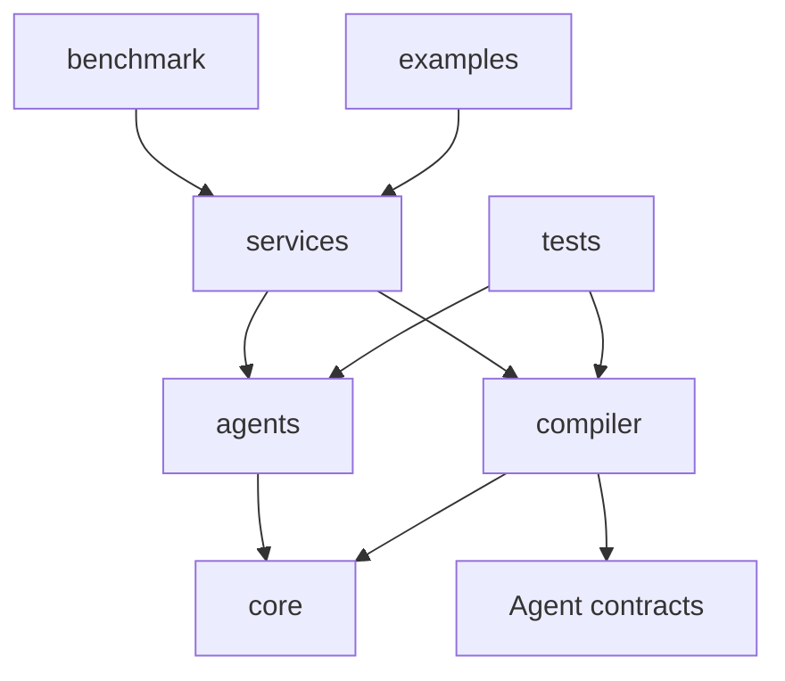

**The runtime in `src/` must not import `benchmark/`.** Runtime correctness tests belong in `tests/`; experimental code, tests, and artifacts belong entirely in `benchmark/`.

## Development

Python **3.12+**, with dependencies managed by **uv**. The source package uses `src` imports, following the project layout.

```bash
git clone git@github.com:joaomadruga/AgentCompiler.git
cd AgentCompiler
uv sync --locked
make check
make demo
```

| Command | Current action |
|---|---|
| `make install` | Install development dependencies |
| `make check` | Check syntax, lint, and whitespace |
| `make lint` | Run Ruff |
| `make demo` | Execute a Python-only example with deduplication and dead task elimination |
| `make test` | Reserved pytest command; no unit tests were added or run |

### Python-only execution

```python
import asyncio
from src import AgentCompiler
from examples.parallel_plan import build_plan, build_registry

async def main():
    compiler = AgentCompiler(build_registry())
    report = await compiler.execute(build_plan())
    print(report.outputs)  # {"summary": {"total_words": 10}}
    print(report.changes)

asyncio.run(main())
```

The example performs real Python operations. Its five-task plan becomes three executions through deduplication and removal of unused pure work. This demonstrates functionality, not a benchmark or a latency claim.

### LLM planning and synthesis

Configure `.env` from `.env.example`, then run:

```bash
uv run python -m examples.llm_orchestration "Count words in these texts: hello world; graphs enable parallel execution"
```

```python
from src import ExecutionService, Settings, build_llm
from examples.parallel_plan import build_registry

async def run_request(request):
    settings = Settings()
    async with build_llm(settings) as model:
        service = ExecutionService.from_model(build_registry(), model, settings)
        result = await service.run(request)
        return result
```

The built-in adapter uses OpenAI-compatible **Chat Completions**. JSON mode is the default; responses are locally validated against Pydantic and JSON Schema contracts, with bounded repair attempts. Optional `json_schema` mode is non-strict and still uses local validation. Models requiring a different API need an injected `LanguageModel` adapter. No live API request is required for `make demo`.

`LLMAgent` accepts a model, a role prompt, an `AgentSpec`, and optional tools. Research the prompt techniques in the connected Research Agent before authoring or changing any prompt.

### CLI and tracing

```bash
uv run python -m src "Your request" --factory your_app:create_service --trace run.jsonl
```

The factory returns an `ExecutionService` (directly or asynchronously), or an async context manager yielding one. A factory that owns an LLM client should use the context-manager form to close it. `--output report.json` writes the run report instead of printing it.

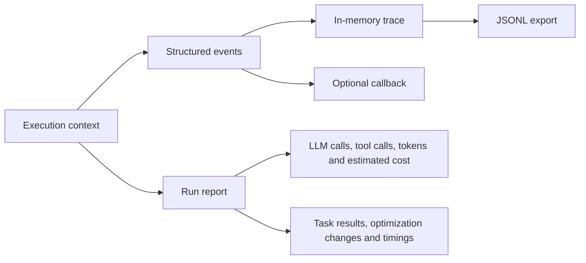

Tracing does not emit prompts or task outputs by default. Reports do contain task outputs; store them accordingly. Token usage comes from provider responses. Calls with no returned usage still count as attempts. Cost estimates use explicitly configured per-million-token prices; zero defaults mean prices are unconfigured, not that the provider is free.

| Setting prefix: `AGENTCOMPILER_` | Default |
|---|---|
| `MAX_CONCURRENCY` / `MAX_TASKS` | 4 / 128 across the run |
| `MAX_ROUNDS` / `MAX_PLAN_ATTEMPTS` | 3 / 3 per structured invocation |
| `MAX_TASK_ATTEMPTS` | 2, only for retry-safe agents |
| `MAX_TOOL_CALLS` / `MAX_LLM_CALLS` | 12 per specialist invocation / 100 per run |
| `RUN_TIMEOUT_SECONDS` / `TASK_TIMEOUT_SECONDS` | 300 / 60 |
| `LLM_TIMEOUT_SECONDS` / `LLM_MAX_TOKENS` | 60 / 4096 |
| `SCHEDULING` / `OPTIMIZE` | `fifo` / `true` |
| `LLM_MODEL` / `STRUCTURED_MODE` | `gpt-4o-mini` / `json_object` |

See [runtime settings](src/core/config.py) and [.env.example](.env.example) for every option.

**All repository content must be written in English**, including documentation, diagrams, code comments, docstrings, prompts, and developer-facing messages. This project rule is recorded in [AGENTS.md](AGENTS.md).

## Implementation roadmap

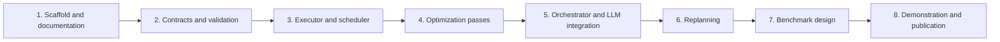

| Implemented | Deferred |
|---|---|
| Runtime, optimization passes, tools, and bounded replanning | Benchmark scenarios and protocol |
| Visual documentation and runnable examples | Live-provider quality and latency evaluation |
| FIFO and estimated critical-path scheduling | Streaming planning and further passes |

Validation for this implementation consisted of syntax/lint checks and manual integration runs, including an actual SDK request to a local HTTP endpoint. Those runs exercised plan repair, synthesis, two-round replanning, tool execution, concurrency, serialization, retries, failures, reference validation, and deadline cleanup. They are not evidence of live-model quality or benchmark gains.

## References

- [An LLM Compiler for Parallel Function Calling — Kim et al., ICML 2024](https://arxiv.org/pdf/2312.04511): dependency planning, Task Fetching Unit, asynchronous execution, and streaming planning.
- [Previous AgentCompiler implementation](https://github.com/joaomadruga/pipeline-task-automation): original undergraduate thesis project.
- [LLVM: Analysis and Transform Passes](https://llvm.org/docs/Passes.html): reference for redundancy and dead code elimination.

This reconstruction adapts compilation ideas to agent orchestration. It does not reproduce the LLMCompiler experiments, and the gains published in that paper are not results of this project.
