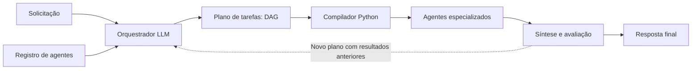
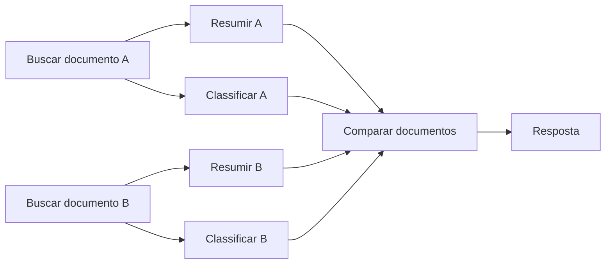
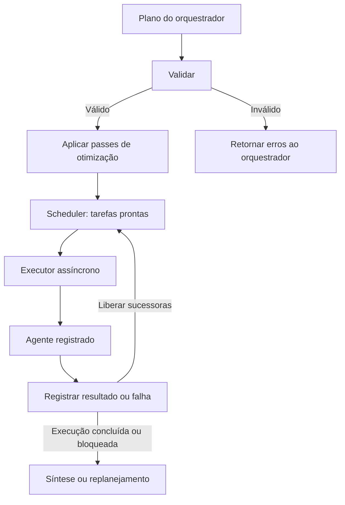
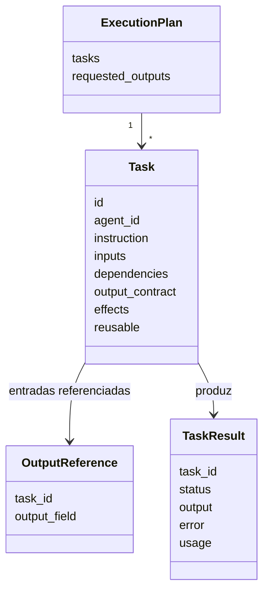
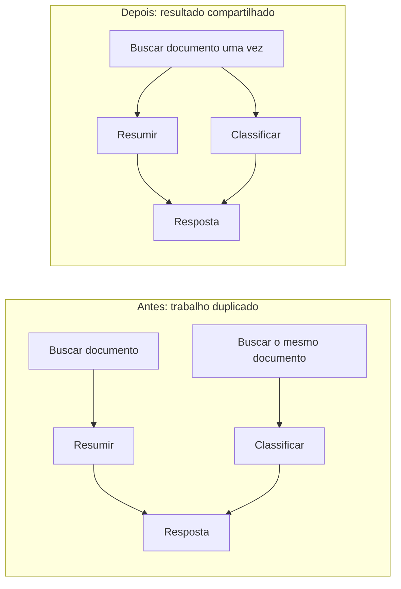
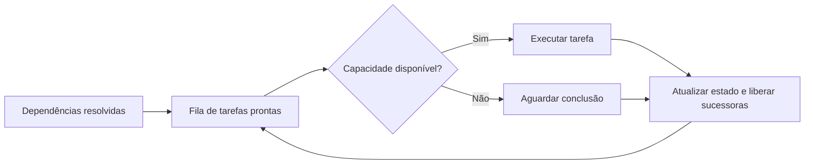
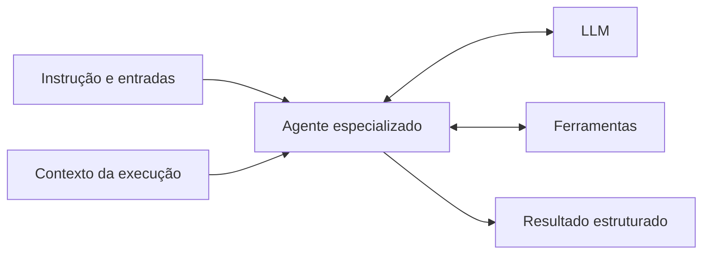
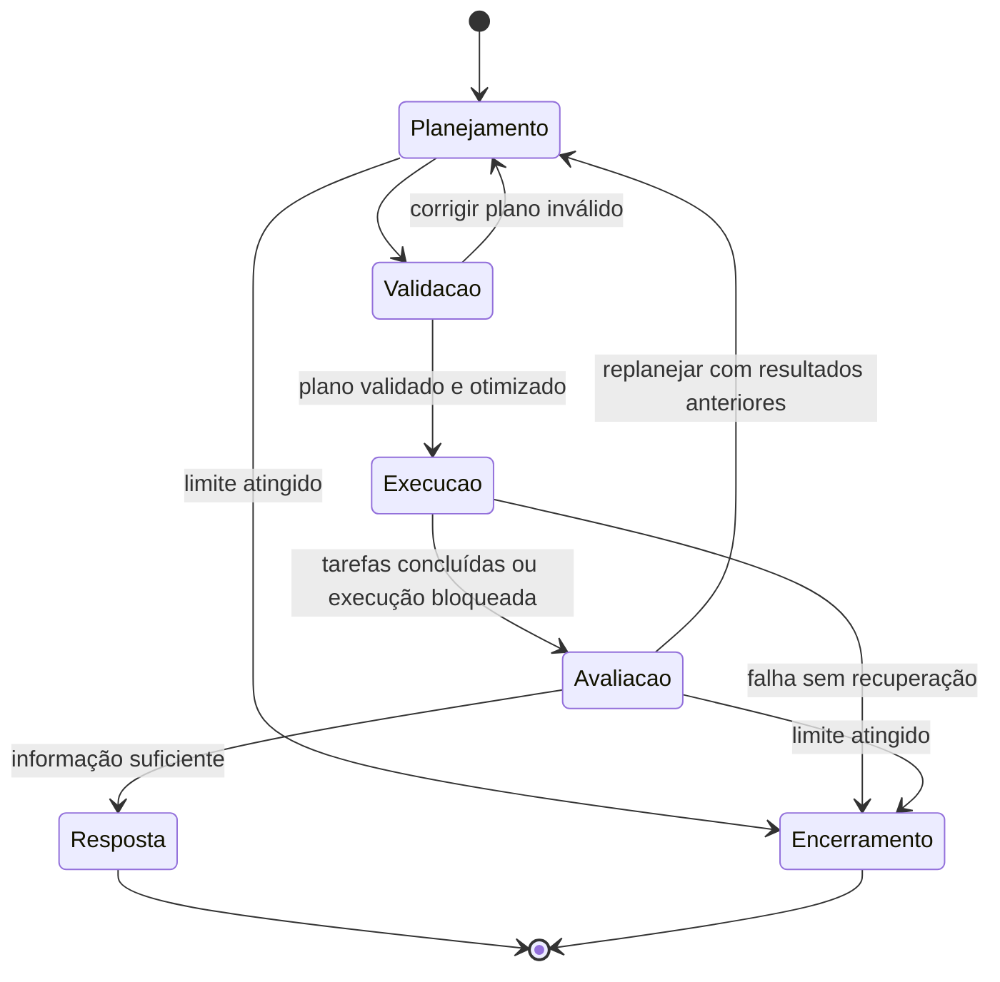
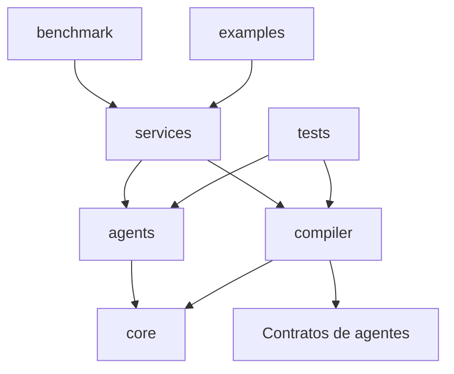
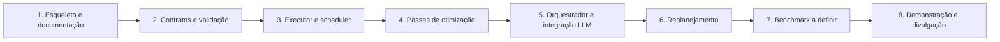

# AgentCompiler

**Orquestração de agentes inspirada em compiladores, com planos estruturados e execução orientada a dependências.**

Evolução do TCC **AgentCompiler: Compilador LLM para Orquestração Paralela de Multiagentes**, de João Pedro de Moraes Madruga, no Centro de Informática da UFPE, orientado por Filipe Carlos de Albuquerque Calegario.

> **Status: esqueleto inicial.** Os módulos Python contêm apenas suas responsabilidades. Os diagramas descrevem a arquitetura planejada; planejamento, otimizações, execução e benchmarks ainda não estão implementados. Não há resultados de desempenho desta versão.

## Visão geral



| O LLM decide | O Python controla |
|---|---|
| Decomposição da solicitação | Validação dos contratos e do grafo |
| Especialistas necessários | Otimizações autorizadas pelo contrato |
| Entradas e dependências semânticas | Agendamento e concorrência |
| Síntese e necessidade de replanejar | Estado, limites, falhas e resultados |

## Por que um grafo?

Uma tarefa pode alimentar vários consumidores, e uma tarefa pode depender de vários resultados. O plano representa essas relações explicitamente em um **grafo acíclico dirigido (DAG)**.



**Dependência determina disponibilidade; posição no plano não impõe uma barreira.** Resumir A pode começar assim que buscar A termina, mesmo que buscar B ainda esteja em execução.

## Pipeline do compilador



| Etapa | Responsabilidade planejada |
|---|---|
| Validação | IDs únicos, agentes registrados, referências válidas, contratos compatíveis e ausência de ciclos |
| Otimização | Transformar o grafo preservando as saídas solicitadas e os efeitos declarados |
| Scheduler | Liberar tarefas com dependências satisfeitas, respeitando o limite de concorrência |
| Executor | Invocar agentes, aplicar limites e registrar término ou falha |
| Síntese | Produzir a resposta ou solicitar outra rodada de planejamento |

### Contratos do plano



Os nomes acima são conceituais; os schemas Python serão definidos na implementação. Cada tarefa recebe sua instrução e as entradas necessárias, com referências explícitas às saídas anteriores.

## Otimizações planejadas

O compilador terá passes separados do planejador e do executor. A primeira implementação deve favorecer transformações verificáveis.



| Pass inicial | Condição para aplicar |
|---|---|
| Deduplicação | Mesma operação, argumentos e contexto relevante; resultado explicitamente reutilizável |
| Eliminação de tarefas mortas | Saída não alcança nenhum resultado solicitado e tarefa não possui efeitos observáveis |

Duas chamadas LLM com instruções semelhantes não são automaticamente equivalentes. Avaliações independentes devem continuar independentes. Escritas e outras ações externas precisam de efeitos declarados para evitar transformações incorretas.

### Agendamento



| Primeira versão | Evoluções a avaliar |
|---|---|
| Liberação baseada em ordenação topológica, como Kahn | Prioridade por caminho crítico estimado |
| Execução conforme tarefas ficam prontas | Estimativas de duração a partir de tracing |
| Plano completo antes da execução | Planejamento em streaming |

Ordenação topológica garante uma ordem válida; não garante a menor latência. O benefício depende das dependências, da duração das tarefas e dos limites de recursos.

## Agentes especializados



O registro descreve capacidades e contratos. O compilador agenda tarefas, e o mesmo agente pode executar tarefas distintas. A implementação deverá declarar se o agente suporta invocações concorrentes.

Especialistas de atendimento, pesquisa e outros cenários experimentais serão definidos futuramente dentro de `benchmark/`, sem acoplar o núcleo a um domínio específico.

## Ciclo de execução



Replanejamento deve preservar os resultados válidos da execução. Tentativas por falha técnica pertencem ao executor; mudanças no caminho de resolução pertencem ao orquestrador. Rodadas, tentativas, concorrência e duração precisam de limites explícitos.

## Organização do repositório

```text
AgentCompiler/
├── src/
│   ├── agents/
│   │   ├── orchestrator/
│   │   │   ├── agent.py
│   │   │   ├── schemas.py
│   │   │   └── prompts/
│   │   │       ├── planning.py
│   │   │       └── synthesis.py
│   │   ├── base.py
│   │   ├── registry.py
│   │   ├── context.py
│   │   └── schemas.py
│   ├── compiler/
│   │   ├── compiler.py
│   │   ├── schemas.py
│   │   ├── validation.py
│   │   ├── scheduler.py
│   │   ├── executor.py
│   │   └── optimizations/
│   │       ├── deduplication.py
│   │       └── dead_tasks.py
│   ├── core/
│   │   ├── config.py
│   │   ├── llm.py
│   │   └── tracing.py
│   └── services/
│       └── execution_service.py
├── benchmark/
│   ├── README.md
│   ├── run.py
│   ├── harness.py
│   ├── configs/
│   ├── datasets/
│   ├── scenarios/
│   ├── baselines/
│   ├── evaluation/
│   ├── tests/
│   ├── results/
│   └── reports/
├── tests/
├── examples/
├── docs/
├── pyproject.toml
├── uv.lock
├── Makefile
└── .env.example
```

Arquitetura inspirada na organização do [nino-backend](https://github.com/joaomadruga/nino-backend): agentes com prompts e schemas locais, infraestrutura compartilhada em `core/` e composição em `services/`.



**O runtime em `src/` não importa `benchmark/`.** Testes de correção do núcleo ficam em `tests/`; código, testes e artefatos experimentais ficam integralmente em `benchmark/`.

## Desenvolvimento

Python **3.12+**, com dependências gerenciadas por **uv**. Ainda não existe CLI de execução do AgentCompiler.

```bash
git clone git@github.com:joaomadruga/AgentCompiler.git
cd AgentCompiler
uv sync
make check
```

| Comando | Ação atual |
|---|---|
| `make install` | Instala dependências de desenvolvimento |
| `make check` | Verifica sintaxe, lint e whitespace |
| `make lint` | Executa Ruff |
| `make test` | Executa pytest; a pasta ainda não contém testes, portanto retorna “no tests collected” |

Não há dependências de runtime nem chaves obrigatórias nesta etapa. A integração com modelos será definida ao implementar `core/llm.py`.

## Próximas etapas



| Agora | Depois |
|---|---|
| Estrutura do AgentCompiler | Implementação e testes de correção |
| Documentação visual da arquitetura | Definição de casos de uso e benchmarks |
| Esqueleto de `benchmark/` | Resultados reproduzíveis e gráficos medidos |

## Referências

- [An LLM Compiler for Parallel Function Calling — Kim et al., ICML 2024](https://arxiv.org/pdf/2312.04511): planejamento de dependências, Task Fetching Unit, execução assíncrona e planejamento em streaming.
- [Implementação anterior do AgentCompiler](https://github.com/joaomadruga/pipeline-task-automation): origem do projeto de TCC.
- [LLVM: Analysis and Transform Passes](https://llvm.org/docs/Passes.html): referência para eliminação de redundâncias e código morto.

Esta reconstrução adapta ideias de compilação à orquestração de agentes. Não constitui uma reprodução dos experimentos do LLMCompiler, e os ganhos publicados naquele artigo não são resultados deste projeto.
