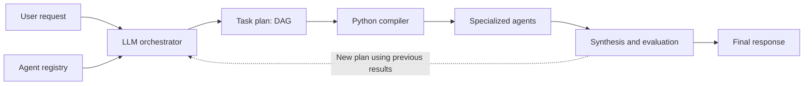
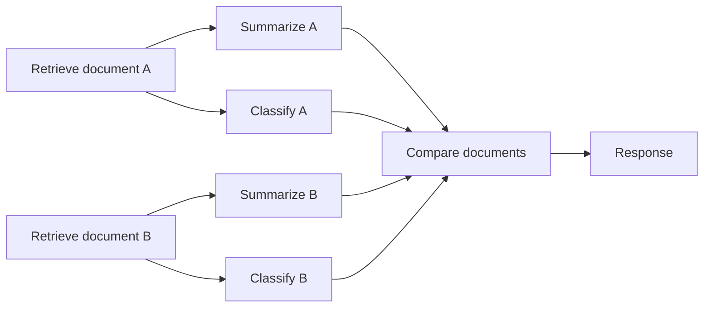
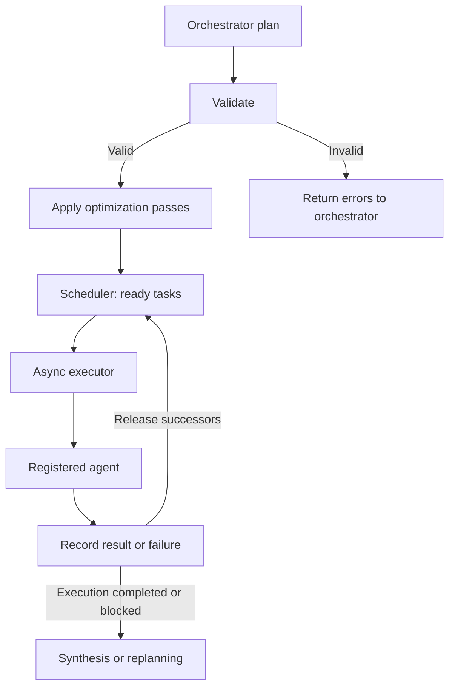
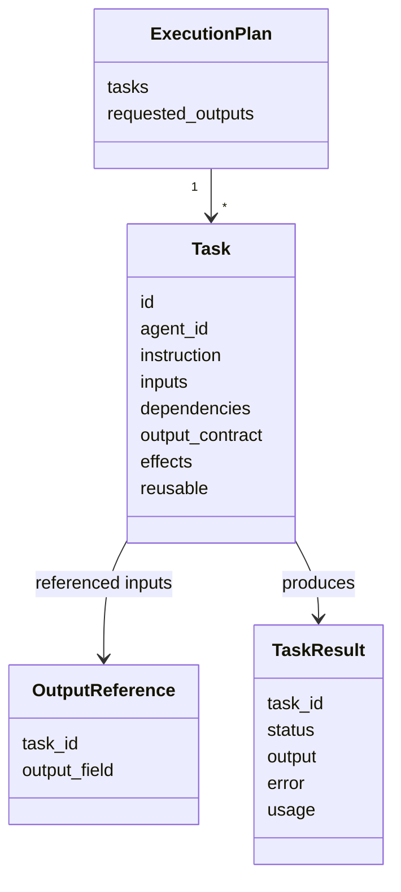
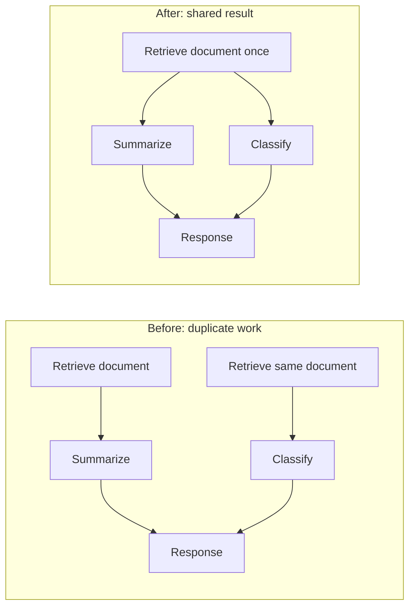
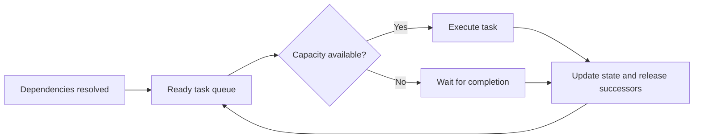
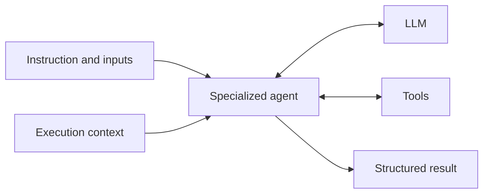
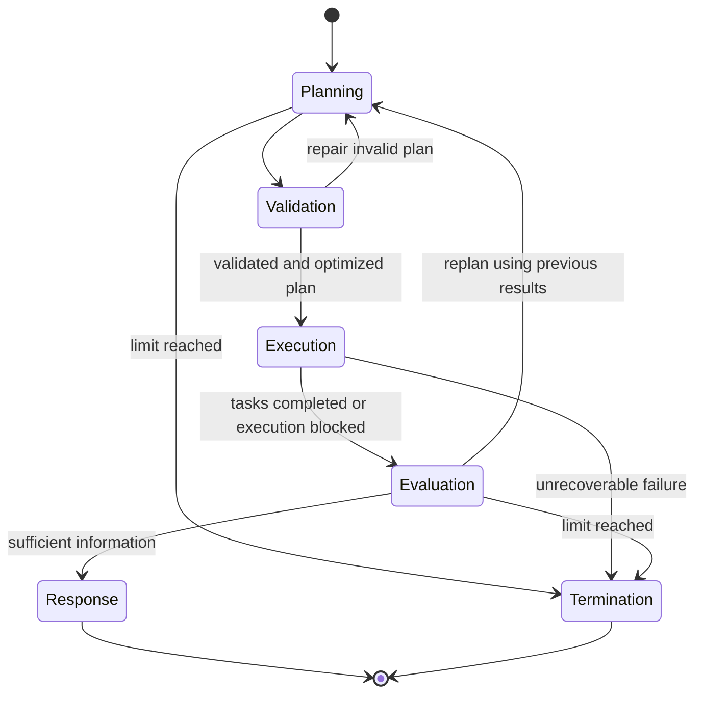
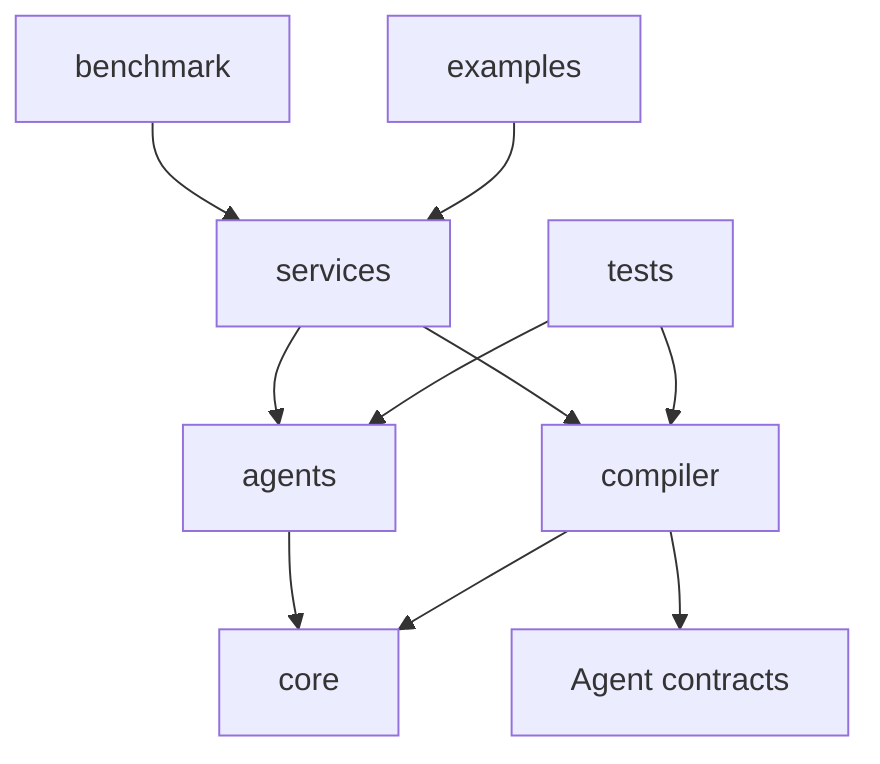
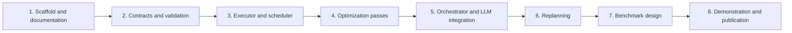

# AgentCompiler

**Compiler-inspired agent orchestration through structured plans and dependency-driven execution.**

A continuation of the undergraduate thesis **AgentCompiler: An LLM Compiler for Parallel Multi-Agent Orchestration**, by João Pedro de Moraes Madruga at the Federal University of Pernambuco (UFPE), Center for Informatics, supervised by Filipe Carlos de Albuquerque Calegario.

> **Status: initial scaffold.** Python modules currently document their intended responsibilities only. The diagrams describe the planned architecture; planning, optimization, execution, and benchmarks are not implemented yet. This version has no performance results.

## Overview



| The LLM decides | Python controls |
|---|---|
| Request decomposition | Contract and graph validation |
| Required specialists | Contract-permitted optimizations |
| Inputs and semantic dependencies | Scheduling and concurrency |
| Synthesis and whether to replan | State, limits, failures, and results |

## Why a graph?

A task may feed multiple consumers, and a task may depend on multiple results. The plan explicitly represents these relationships as a **directed acyclic graph (DAG)**.



**Dependencies determine readiness; position in the plan does not impose a barrier.** Summarizing A can start as soon as retrieving A finishes, even while retrieving B is still running.

## Compiler pipeline



| Stage | Planned responsibility |
|---|---|
| Validation | Unique IDs, registered agents, valid references, compatible contracts, and absence of cycles |
| Optimization | Transform the graph while preserving requested outputs and declared effects |
| Scheduler | Release tasks with satisfied dependencies within the concurrency limit |
| Executor | Invoke agents, enforce limits, and record completion or failure |
| Synthesis | Produce the response or request another planning round |

### Plan contracts



These names are conceptual; Python schemas will be defined during implementation. Each task receives its instruction and required inputs, with explicit references to preceding outputs.

## Planned optimizations

The compiler will have passes separate from the planner and executor. The initial implementation should favor verifiable transformations.



| Initial pass | Application condition |
|---|---|
| Deduplication | Same operation, arguments, and relevant context; explicitly reusable result |
| Dead task elimination | Output does not contribute to any requested result and the task has no observable effects |

Two LLM calls with similar instructions are not automatically equivalent. Independent evaluations must remain independent. Writes and other external actions need declared effects to prevent incorrect transformations.

### Scheduling



| Initial version | Potential extensions |
|---|---|
| Task release based on topological ordering, such as Kahn's algorithm | Priority based on estimated critical path |
| Execution as tasks become ready | Duration estimates from tracing |
| Complete plan before execution | Streaming planning |

Topological ordering guarantees a valid order, not minimum latency. Benefits depend on dependencies, task duration, and resource limits.

## Specialized agents



The registry describes capabilities and contracts. The compiler schedules tasks, and the same agent may execute distinct tasks. The implementation must declare whether an agent supports concurrent invocations.

Customer support, research, and other experimental specialists will be defined later inside `benchmark/`, keeping the runtime independent of a specific domain.

## Execution lifecycle



Replanning should preserve valid execution results. Technical retries belong to the executor; changes to the resolution strategy belong to the orchestrator. Rounds, attempts, concurrency, and duration need explicit limits.

## Repository layout

```text
AgentCompiler/
├── AGENTS.md
├── src/
│   ├── agents/
│   │   ├── orchestrator/
│   │   │   ├── agent.py
│   │   │   ├── schemas.py
│   │   │   └── prompts/
│   │   │       ├── planning.py
│   │   │       └── synthesis.py
│   │   ├── base.py
│   │   ├── registry.py
│   │   ├── context.py
│   │   └── schemas.py
│   ├── compiler/
│   │   ├── compiler.py
│   │   ├── schemas.py
│   │   ├── validation.py
│   │   ├── scheduler.py
│   │   ├── executor.py
│   │   └── optimizations/
│   │       ├── deduplication.py
│   │       └── dead_tasks.py
│   ├── core/
│   │   ├── config.py
│   │   ├── llm.py
│   │   └── tracing.py
│   └── services/
│       └── execution_service.py
├── benchmark/
│   ├── README.md
│   ├── run.py
│   ├── harness.py
│   ├── configs/
│   ├── datasets/
│   ├── scenarios/
│   ├── baselines/
│   ├── evaluation/
│   ├── tests/
│   ├── results/
│   └── reports/
├── tests/
├── examples/
├── docs/
├── pyproject.toml
├── uv.lock
├── Makefile
└── .env.example
```

Architecture inspired by [nino-backend](https://github.com/joaomadruga/nino-backend): agents with local prompts and schemas, shared infrastructure in `core/`, and composition in `services/`.



**The runtime in `src/` must not import `benchmark/`.** Runtime correctness tests belong in `tests/`; experimental code, tests, and artifacts belong entirely in `benchmark/`.

## Development

Python **3.12+**, with dependencies managed by **uv**. There is no AgentCompiler execution CLI yet.

```bash
git clone git@github.com:joaomadruga/AgentCompiler.git
cd AgentCompiler
uv sync
make check
```

| Command | Current action |
|---|---|
| `make install` | Install development dependencies |
| `make check` | Check syntax, lint, and whitespace |
| `make lint` | Run Ruff |
| `make test` | Run pytest; no tests exist yet, so it reports “no tests collected” |

No runtime dependencies or API keys are required at this stage. Model integration will be defined when implementing `core/llm.py`.

**All repository content must be written in English**, including documentation, diagrams, code comments, docstrings, prompts, and developer-facing messages. This project rule is recorded in [AGENTS.md](AGENTS.md).

## Next steps



| Now | Later |
|---|---|
| AgentCompiler structure | Implementation and correctness tests |
| Visual architecture documentation | Use case and benchmark design |
| `benchmark/` scaffold | Reproducible results and measured charts |

## References

- [An LLM Compiler for Parallel Function Calling — Kim et al., ICML 2024](https://arxiv.org/pdf/2312.04511): dependency planning, Task Fetching Unit, asynchronous execution, and streaming planning.
- [Previous AgentCompiler implementation](https://github.com/joaomadruga/pipeline-task-automation): original undergraduate thesis project.
- [LLVM: Analysis and Transform Passes](https://llvm.org/docs/Passes.html): reference for redundancy and dead code elimination.

This reconstruction adapts compilation ideas to agent orchestration. It does not reproduce the LLMCompiler experiments, and the gains published in that paper are not results of this project.
