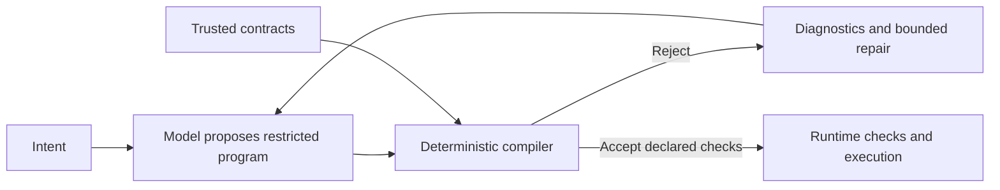

# Architecture: checked action programs

## Target responsibility boundary

The model interprets intent and proposes actions. The compiler checks properties that have been explicitly encoded. Execution is deterministic with respect to declared dispatch rules and observed task state; model outputs and external systems remain nondeterministic.

| Layer | Existing foundation | Proposed extension |
|---|---|---|
| Action representation | Tasks, agent IDs, named bindings, output references, DAG | Define a restricted action language and its semantics |
| Trusted contracts | Pydantic input/output classes, generated JSON schemas, nominal inheritance checks; effect/reuse/retry/concurrency metadata | Explicit state preconditions/postconditions and enforceable effect policies |
| Compilation | Identities, references, cycles, known paths, nominal types and conservative union compatibility | Requirement coverage and richer contract analysis |
| Repair | Structured rule/task/input/type diagnostics, rejected-candidate context and bounded attempts | Precise rule diagnostics and correction scope |
| Execution | Strict Pydantic and custom-validator checks, JSON fallback, limits and dependency dispatch | Recheck dynamic conditions and verify declared postconditions |
| Model policy | Configured caller-supplied models | Optional bounded escalation; research hypothesis only |

## Existing behavior

- `AgentSpec` is trusted configuration; the planner cannot redefine effects or reuse permissions.
- Input bindings use literal JSON or RFC 6901 output references. Full schema checks run on resolved inputs and actual outputs.
- Deduplication is local to a plan and requires explicit reuse permission. Dead task elimination preserves read/write tasks and their prerequisites.
- FIFO or estimated-critical-path scheduling releases tasks without layer barriers. Nonconcurrent agents serialize across runs sharing a registry on one event loop.
- Task failures block dependents; deadlines cancel outstanding tasks and preserve partial results. Replanning uses fresh IDs and may explicitly reference successful previous results.
- The built-in provider uses Chat Completions with locally validated structured responses and bounded repair.

## Limits of the guarantee

Acceptance establishes only encoded checks, under trusted contract assumptions. Structural validity does not establish factual correctness, correct intent interpretation, or successful external actions. Dynamic state can change between planning and execution. Retry safety is a declared contract, not something the compiler can infer from natural language.

## Organization

Keep the Nino-inspired Python layout: local agent schemas/prompts, shared `core/`, deterministic `compiler/`, and lifecycle composition in `services/`. Runtime must not import `benchmark/`. All experimental code and artifacts stay there. Typed Pydantic contracts and diagnostic-guided repair are implemented; broader state and effect mechanisms remain proposed.

## Pydantic boundary

`AgentSpec.input_model` is a Pydantic object model; `output_model` is a model or model union. Typed models generate the schemas while registry snapshots preserve class identity. Catalogs expose names, fields and ancestry without serializing Python classes.

The compiler uses nominal subtyping for models and conservative branch compatibility: every producer alternative must fit some consumer alternative. Nested paths must be available across all branches. Supported container element types are checked recursively; field constraints, dynamic key/index existence and custom validators remain runtime obligations.

Typed references require typed producers, including successful previous results identified by their registered agent. Legacy schema registrations remain available. RootModel wrappers, aliases, and excluded fields are not supported for typed contracts. Literal model-shaped data establishes only validation, not trusted business evidence.

The executor validates producer outputs and resolved inputs using strict JSON semantics. Base-typed model inputs expose base fields to JSON handlers. Failed output validation blocks dependents. Internal LLM tool calls also run Pydantic validation, but remain opaque to static plan analysis. Deterministic, validation-only or idempotent validators are required; external checks belong in actions. Explicit state contracts and conditional union branching are not implemented.

## Validation references

- [Pydantic models](https://docs.pydantic.dev/latest/concepts/models/): validation and serialization boundaries.
- [Pydantic strict mode](https://docs.pydantic.dev/latest/concepts/strict_mode/): strict JSON semantics differ from strict Python-object validation.

Nominal plan compatibility and structured compiler diagnostics are AgentCompiler policies layered over Pydantic, not guarantees supplied by JSON Schema alone.
