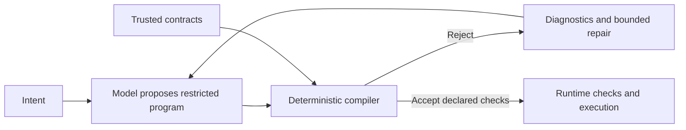

# Architecture: checked action programs

## Target responsibility boundary

The model interprets intent and proposes actions. The compiler checks properties that have been explicitly encoded. Execution is deterministic with respect to declared dispatch rules and observed task state; model outputs and external systems remain nondeterministic.

| Layer | Existing foundation | Proposed extension |
|---|---|---|
| Action representation | Tasks, agent IDs, named bindings, output references, DAG | Define a restricted action language and its semantics |
| Trusted contracts | JSON schemas; effect, reuse, retry and concurrency metadata | Explicit state preconditions/postconditions and enforceable effect policies |
| Compilation | Identities, references, cycles, known paths and provable type incompatibility | Requirement coverage and richer contract analysis |
| Repair | Validation feedback and bounded structured-plan attempts | Precise rule diagnostics and correction scope |
| Execution | Resolved-input/output validation, limits, dependency dispatch | Recheck dynamic conditions and verify declared postconditions |
| Model policy | Configured caller-supplied models | Optional bounded escalation; research hypothesis only |

## Existing behavior

- `AgentSpec` is trusted configuration; the planner cannot redefine effects or reuse permissions.
- Input bindings use literal JSON or RFC 6901 output references. Full schema checks run on resolved inputs and actual outputs.
- Deduplication is local to a plan and requires explicit reuse permission. Dead task elimination preserves read/write tasks and their prerequisites.
- FIFO or estimated-critical-path scheduling releases tasks without layer barriers. Nonconcurrent agents serialize across runs sharing a registry on one event loop.
- Task failures block dependents; deadlines cancel outstanding tasks and preserve partial results. Replanning uses fresh IDs and may explicitly reference successful previous results.
- The built-in provider uses Chat Completions with locally validated structured responses and bounded repair.

## Limits of the guarantee

Acceptance establishes only encoded checks, under trusted contract assumptions. Structural validity does not establish factual correctness, correct intent interpretation, or successful external actions. Dynamic state can change between planning and execution. Retry safety is a declared contract, not something the compiler can infer from natural language.

## Organization

Keep the Nino-inspired Python layout: local agent schemas/prompts, shared `core/`, deterministic `compiler/`, and lifecycle composition in `services/`. Runtime must not import `benchmark/`. All experimental code and artifacts stay there. This revision changes documentation only; no new contract mechanism is implemented.
